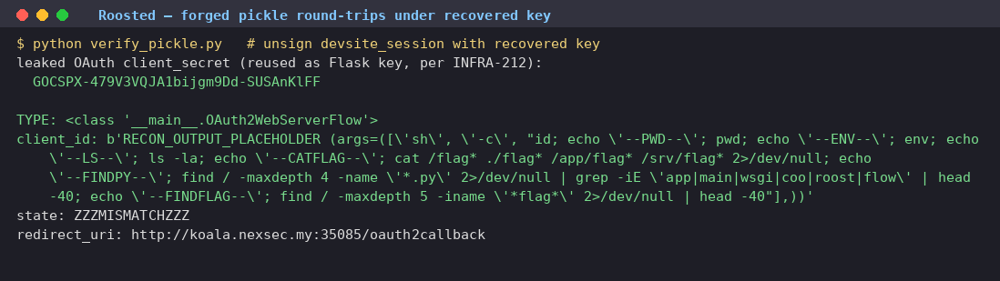

# Roosted

| Field | Value |
|---|---|
| Challenge | Roosted |
| Category | Web |
| Source PDF pages | 4–6 |
| Team name | Not specified in the source PDF |
| Solver names | Not specified in the source PDF |

> This document faithfully formats the technical content from the supplied local PDF. No technical steps, commands, evidence, or flags were added.

Roosted was a "Roost" developer-site app sitting behind a Google-style OAuth sign-in, and it
shipped with a docs/changelog that practically told me how to beat it. The changelog was the
tell: sign-in state is "resume state packed into a compact band code carried by the bird" (so
the OAuth flow is stateless and serialized straight into the cookie), and ticket "INFRA-212:
consolidated config secrets, no standalone key of its own" hinted that the app has no
dedicated session key and reuses another secret to sign things. And the flag text, as I'd find
out, is the author's taunt that no AI agent is needed for this one.

## Challenge details and overview

- Supplied file(s) / service: A "Roost" developer-site web application (Python / Flask)
      behind a Google-style OAuth sign-in, plus a live instance at
      koala.nexsec.my:<port>/oauth2callback. Shipped with a docs/changelog that
      describes the session design.
- Category: Web.
- Initial observation: The changelog is the tell. Sign-in state is "resume state packed
      into a compact band code carried by the bird" (i.e. the OAuth flow is stateless and
      serialized into the cookie), and ticket "INFRA-212: consolidated config secrets, no
      standalone key of its own" hints the app has no dedicated session key and reuses
      another secret for signing. The flag text is the author's taunt: no AI agent is needed
      for this one.

## Enumeration and analysis

The devsite_session cookie is a standard Flask signed cookie. When I decoded its flow field
I found it was base64 of zlib of a Python pickle of the server's OAuth flow object, not JSON.
Decoding: flow = "<value of the flow field from devsite_session>";
 dec = zlib.decompress(base64.b64decode(flow)): pickle stream, not JSON.

Disassembling that pickle leaked the OAuth client secret embedded in the flow object:
client_secret = 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

Per INFRA-212, that same client secret is reused as the Flask session signing key (I later
confirmed it: the server environment literally sets ROOST_CLIENT_SECRET to this value
and the app reuses it as its secret). That's the whole game right there: knowing the signing
key lets me forge any signed devsite_session, and the server unpickles the flow field on
/oauth2callback, which is a deserialization-of-untrusted-data sink ("everything you hand a
bird comes home").

## Signed-cookie forgery and pickle RCE

With the signing key recovered, I forged a session whose flow is a crafted pickle that
executes code on load. The pickle rebuilds the real flow class
(roost_oauth.client.OAuth2WebServerFlow) and, during BUILD, sets client_id to the output
of a shell command via subprocess.check_output(['sh','-c', CMD]):
SECRET = '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'
CMD = "cat /flag* 2>/dev/null" (reflected back via client_id)

Hand-assembled pickle: NEWOBJ OAuth2WebServerFlow, then BUILD a __dict__ whose
client_id = subprocess.check_output(['sh','-c', CMD]); state/redirect_uri/etc. set to benign
values so the flow validates; then base64+zlib compress and sign with
SecureCookieSessionInterface using SECRET.

Confirming execution (timing oracle). Before exfiltrating anything, I fired a sleep 7 payload to
prove the pickle really runs server-side: the /oauth2callback response took 7.4s versus a
baseline 0.6s. That settled it.

Reflecting the flag out. The static directory was read-only, so rather than write a web-served
file, I forged the flow object so its client_id equals the command output. The sign-in error
page echoes the client back ("flow started for …"), which reflected cat /flag* straight into the
HTML response.

The target ran as user pigeon under gunicorn, with the Flask app at /app/app.py, and the flag
file was /flag-7490617e732645b0f7385d42.txt. I drove the whole thing through the
authenticated Chrome session over CDP at human pace, with no CLI against the challenge
site.

## Flag retrieval and proof

For proof, it was read directly from /flag-7490617e732645b0f7385d42.txt on the server via
the forged-pickle code execution and reflected through the sign-in page, not from any
injected bait. The flag text is itself the author's "no AI agent needed" taunt, which felt fitting.

## Recovered CTF flag

nexsec26{even_my_grandma_dont_need_to_use_ai_agent_for_this_one_a2
c38da9a116d63a88998238f8b13dd2b2083077a4803a3c1449923548a7ea18}

Roosted: forged pickle round-trips under the recovered signing key

## Source Figures

*Original writeup figure — PDF page 5*
