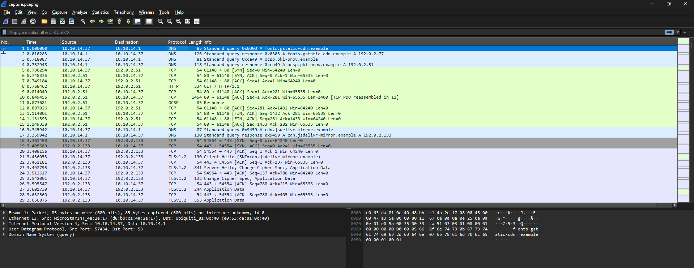
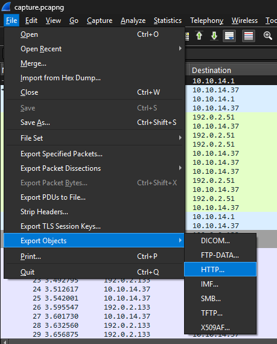
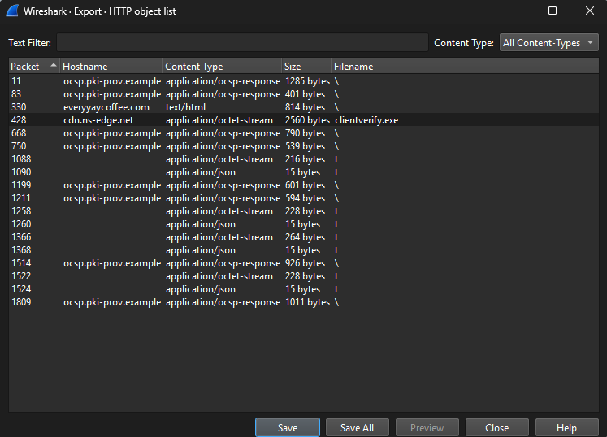
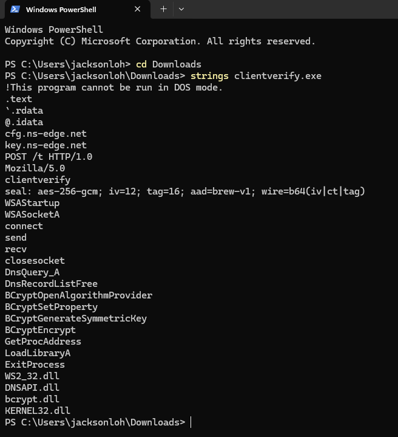
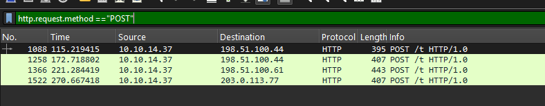
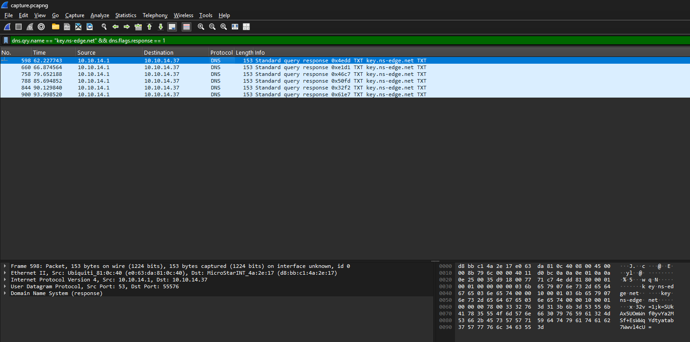

# Dead Drop Latte

| Field | Value |
|---|---|
| Challenge | Dead Drop Latte |
| Category | Forensic |
| Source PDF pages | 11–15 |
| Team name | Not specified in the source PDF |
| Solver names | Not specified in the source PDF |

> This document faithfully formats the technical content from the supplied local PDF. No technical steps, commands, evidence, or flags were added.

A corporate workstation tripped a SOC alert a few minutes after the user trying to
order coffee from a website. Turns out it run malicious command after the user trying
to order it.
We captured its traffic and pulled the machine before re-imaging it.

## Challenge Details & Overview

- Supplied file: Dead_Drop_Latte.zip
- Recovered NEXSEC26 flag :nexsec26{l3ts_buy_s0me_c0ffee_2_stay_awake}
- DeepSeek Conversation Link: https://chat.deepseek.com/share/gcg17nyhfidfcpws4j

## Identify the IP addresses and ports

## RESULTS FROM PCAP FILE

   Likely victim IP
                          10.10.14.37

     DNS server
                           10.10.14.1

      DNS port
                            UDP 53

   Web traffic ports
                            TCP 80

## Identify the suspicious connections

I found a much stronger indicator than ordinary HTTPS traffic: the victim downloads a
Windows executable.

Select the content with clientverify.exe, then click save to the local.

Run the clientverify.exe in powershell through strings to get the details.

From here, we can know that the key can be obtained from ns-edge.net; the flag can be
obtained through AES-256 decryption via GCM, IV = 12 bytes, tag = 16 bytes, AAD =
brew-v1 and with Base64.

Then sends encrypted HTTP POST requests to several unusual ports.

After that I found 6 Base64-encoded keys in the DNS TXT responses for key.ns-edge.net
through dns.qry.name == "key.ns-edge.net" && dns.flags.response == 1

These are the 6 keys that I obtained from above:

1. SUkAx5UOmWnf0yvYa2MSf+EsWWqYdtyatab7Wwvl4cU=

2. bZ8N/+qWBdeONGnJoHgZWpLlmRfMeQiXkQ4cl1L279U=

3. 2OWd6dhYr2jXv4N6KRKk2WPvCVLfb10OC+MspGxV208=

4. N7i8E2HioESNhUN22xJSrdwGuTewqmTaaTGyQ4xw5cM=

5. 3iDg5AXW8wF7nrkxxs2II0imUWgalKIGVqeAnT8sUdI=

6. aOokt/BJuKx0ncTqLq7pqDYmOfuUdIftGLLQSDp/Dhg=

## Recovered CTF flag

The POST bodies use AES-256-GCM encryption; we found their encryption keys in DNS
TXT responses for key.ns-edge.net and successfully decrypted all four POST requests.

The third decrypted request contains:

Recovered flag

nexsec26{l3ts_buy_s0me_c0ffee_2_stay_awake}

## Source Figures

*Original writeup figure — PDF page 11*

*Original writeup figure — PDF page 12*

*Original writeup figure — PDF page 12*

*Original writeup figure — PDF page 13*

*Original writeup figure — PDF page 14*

*Original writeup figure — PDF page 14*
