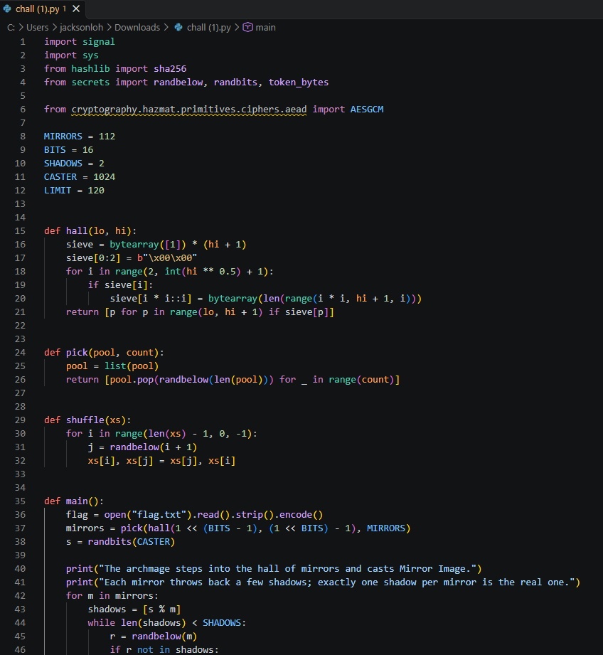
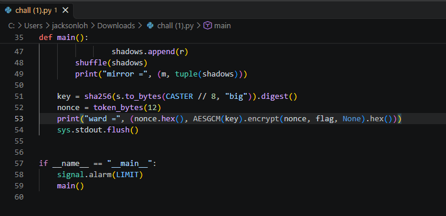
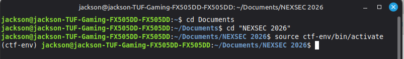
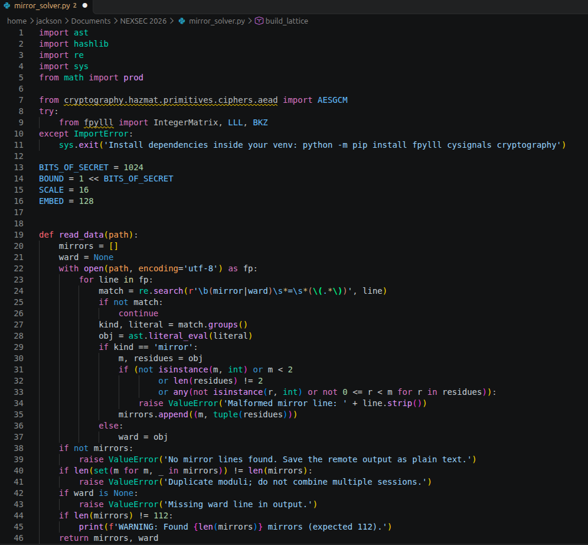
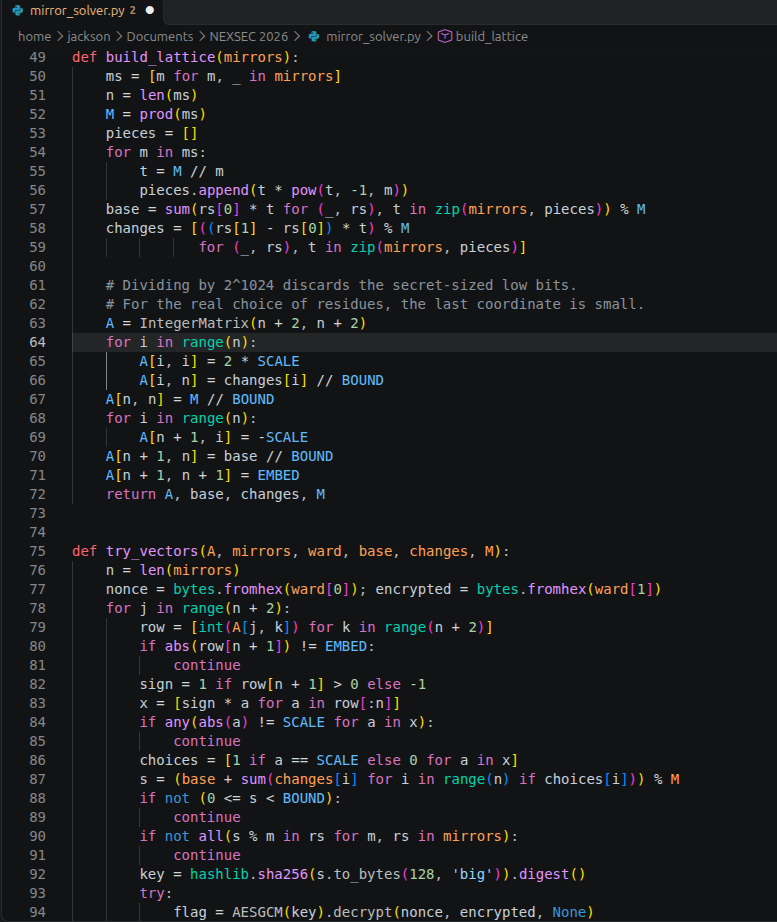
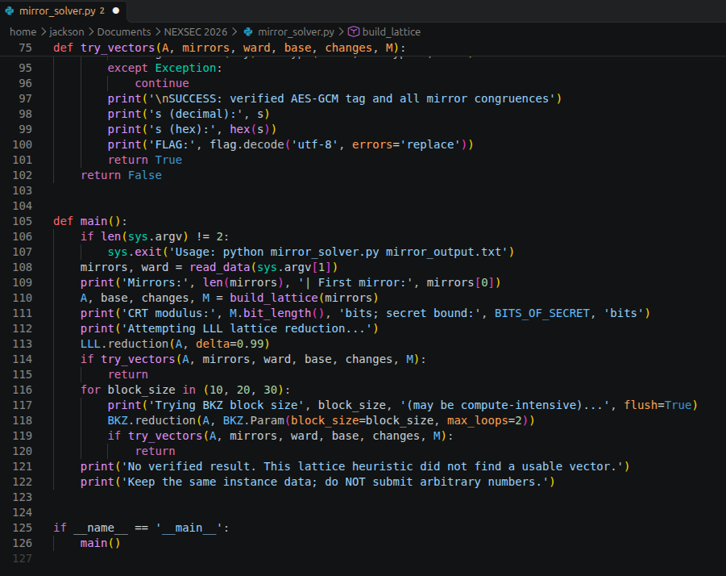
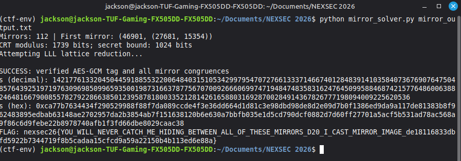

# Mirror Image

| Field | Value |
|---|---|
| Challenge | Mirror Image |
| Category | Crypto |
| Team name | B2F1 |

The archmage knew the party was coming, so he raised a hall of mirrors and
vanished into it with a single spell: Mirror Image.
Every mirror on the wall throws back a handful of shadows of him, but only one
shadow in each mirror is the real archmage, the rest are illusions. Stare at any one
mirror and you cannot tell which is which.
He sealed his escape ward behind his own true form. Catch the caster hiding between
all of those mirrors, or let him walk away.

## Challenge Details & Overview

- Supplied file: chall.py
- Recovered NEXSEC26 flag :
       nexsec26{YOU_WILL_NEVER_CATCH_ME_HIDING_BETWEEN_ALL_OF_THESE_MIRRORS_D20_I_CAST_MIRROR_IMAGE_de18116833dbfd5922b7344719f8b5cadaa15cfcd9a59a22150b4b113ed6e88a}

## Understand the vulnerability

Open the chall.py file in VS Code and view the information provided by the organiser.

These are the important settings:

                                      MIRRORS = 112
                                        BITS = 16
                                      SHADOWS = 2
                                      CASTER = 1024

The server generates a secret:

                                     s = randbits(1024)

Each mirror reveals two possible remainders:

                                    shadows = [s % m]

It then adds one fake remainder and shuffles the two.

We don't know which remainder is genuine.

With 112 mirrors, trying every combination would require:

                                               112
                                             2

That's too many to brute-force.

However, all the moduli are different primes. We can use the Chinese Remainder Theorem
(CRT) to transform this into a modular subset-sum problem, then attempt to solve it using
lattice reduction.

Once we recover s, the rest is straightforward:

                       key = sha256(s.to_bytes(128, "big")).digest()

We use that key to decrypt the AES-GCM ciphertext in ward.

## Capture the remote challenge output

This script does not ask for a seed or secret. It prints all 112 mirrors and an encrypted ward,
then exits.

In my Linux terminal:

Run this command using the actual host and port supplied by the CTF:

nc HOST PORT | tee mirror_output.txt

We should get something like:

The archmage steps into the hall of mirrors and casts Mirror Image.

Each mirror throws back a few shadows; exactly one shadow per mirror is the real
one.

mirror = (49157, (12034, 38721))

mirror = (...)

...

ward = ('nonce_in_hex', 'encrypted_flag_in_hex')

The tee command saves everything into mirror_output.txt

## Prepare the solver

I created an experimental lattice-based solver for this challenge. It uses CRT, LLL/BKZ
lattice reduction and AES-GCM verification.

Save this file as mirror_solver.py in the same directory as mirror_output.txt.

Documents/

└── NEXSEC 2026/
    ├── chall.py
    ├── mirror_solver.py
     └── mirror_output.txt

Then run:

The script will attempt lattice reduction and check whether any candidate satisfies the mirror
equations. A successful candidate must also pass the AES-GCM authentication check.

Output:
FLAG:
nexsec26{YOU_WILL_NEVER_CATCH_ME_HIDING_BETWEEN_ALL_OF_THESE_MIRRORS_D20_I_CAST_MIRROR_IMAGE_de18116833dbfd5922b7344719f8b5cadaa15cfcd9a59a22150b4b113ed6e88a}

## Source Figures

