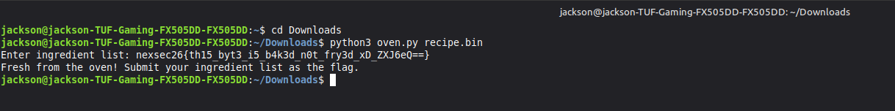
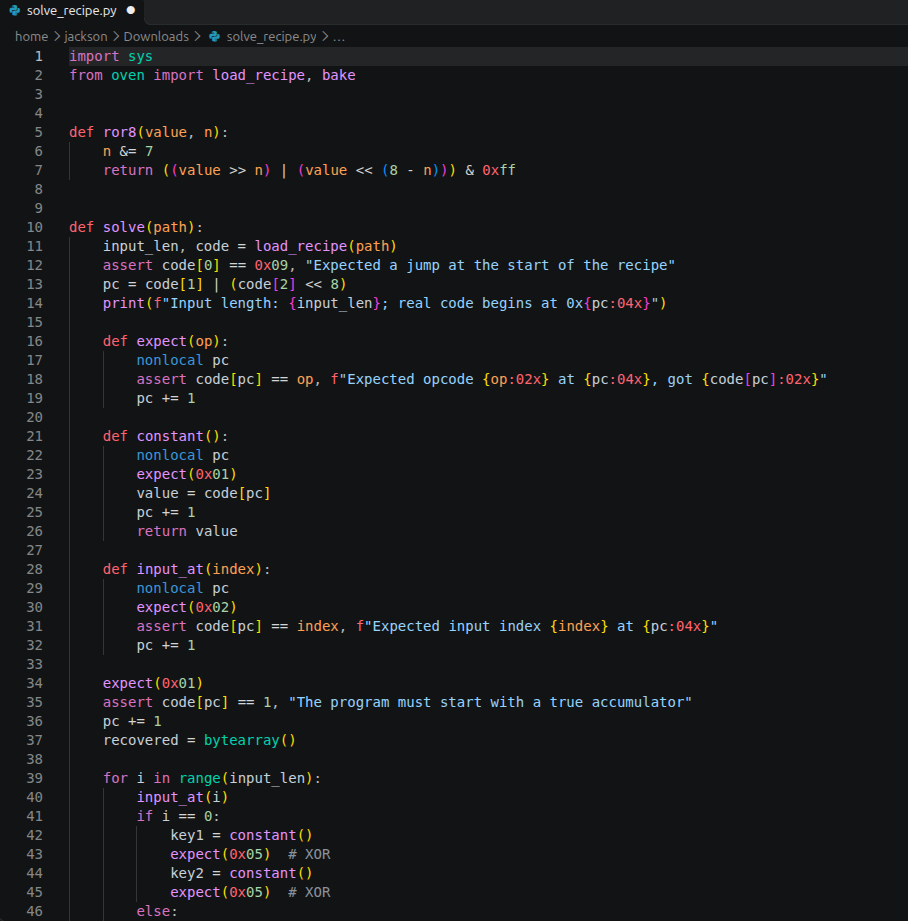
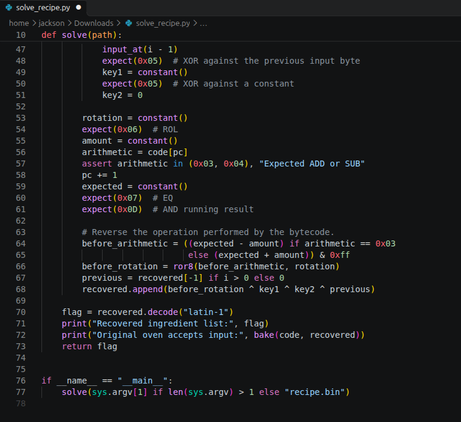
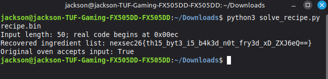

# Bytecode Bakery

| Field | Value |
|---|---|
| Challenge | Bytecode Bakery |
| Category | Reverse Engineering |
| Team name | B2F1 |

The bakery's oven runs its own tiny instruction set. The recipe card checks whether you
know the secret ingredient list. Find the ingredients that bake a perfect loaf.

## Challenge Details & Overview

- Supplied files: oven.py & recipe.bin
- Recovered NEXSEC26 flag : nexsec26{th15_byt3_i5_b4k3d_n0t_fry3d_xD_ZXJ6eQ==}
- DeepSeek Conversation Link: https://chat.deepseek.com/share/5vlm64p89sow6filsy

## Test the flag on Linux Mint

Put oven.py and recipe.bin in the same directory.

When it displays: Enter ingredient list:

Paste the recovered flag and press Enter.

The expected response is: Fresh from the oven! Submit the ingredient list as the flag.

## Reproduce the solution with a Python solver

I've write a script that reverses the bytecode checks and reconstructs the flag automatically.

solve_recipe.py

Save it in the same directory as the two challenge files:

Downloads/
├── oven.py
├── recipe.bin
└── solve_recipe.py

Then run:

Expected output:

Input length: 50; real code begins at 0x00ec
Recovered ingredient list: nexsec26{th15_byt3_i5_b4k3d_n0t_fry3d_xD_ZXJ6eQ==}
Original oven accepts input: True

## Source Figures

