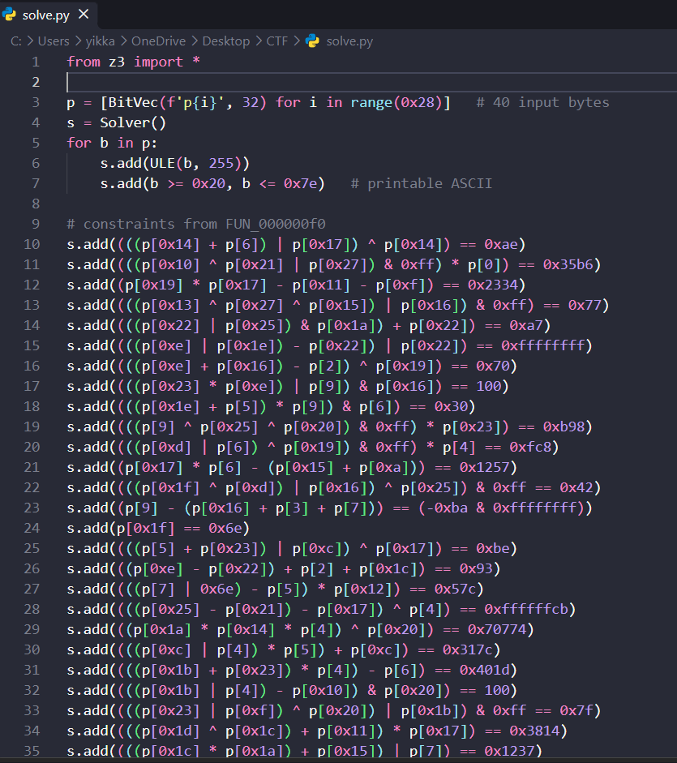
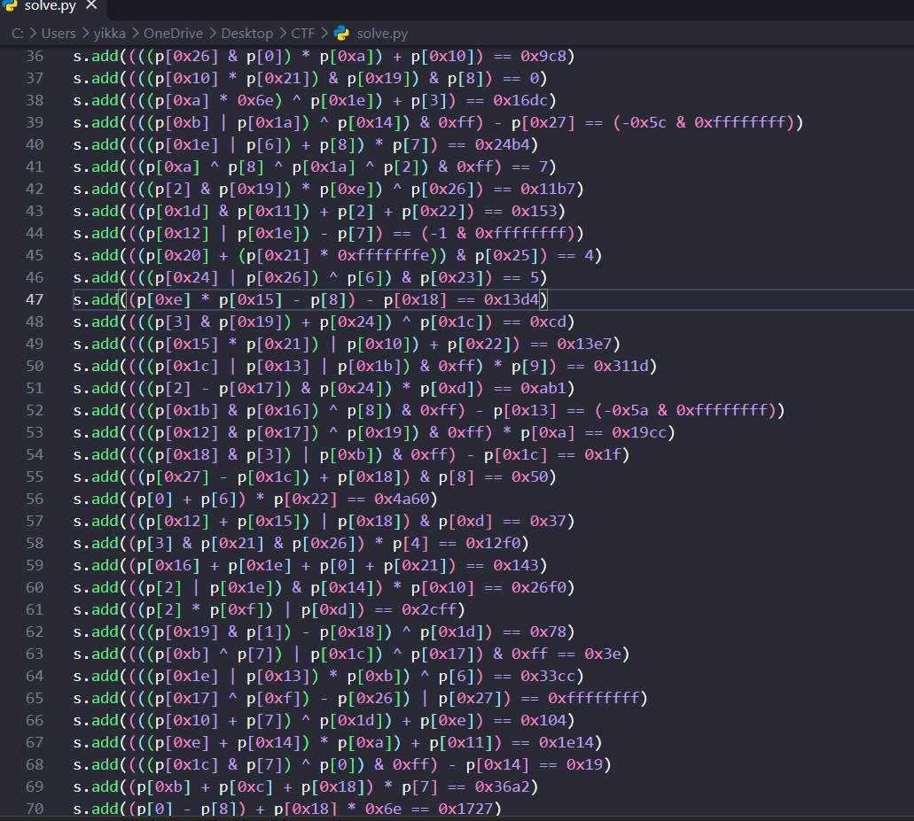
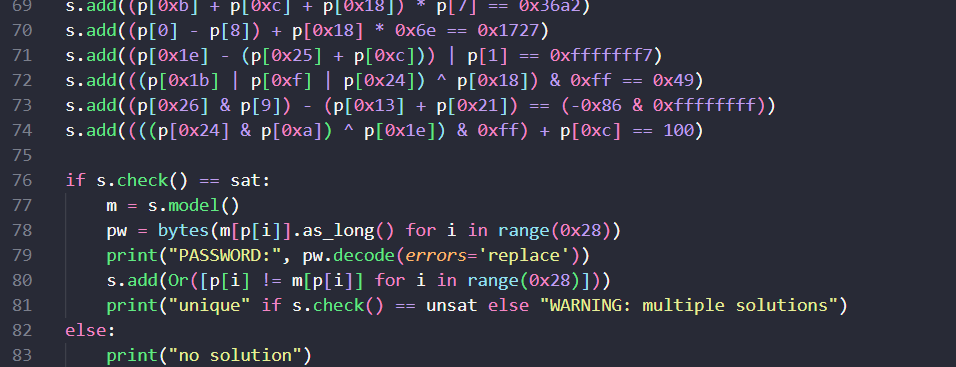
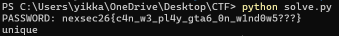

# Flag Checker

| Field | Value |
|---|---|
| Challenge | Flag Checker |
| Category | Reverse Engineering |
| Team name | B2F1 |

## Deepseek Chat Link
DeepSeek Conversation Link: https://chat.deepseek.com/share/xdpkrnxsrwder95ppq

## The setup

The challenge card was pure bait: "My friend just downloaded GTA FLAGCHECKER VI for his new
PlayStation 5 Pro. The game asks for a password upon initial launch. Find the correct password!!" It
handed us a password-protected ZIP and the ZIP password right there on the card.

First annoyance: we're on Windows, and Windows flat out can't unzip a password-protected archive
from Explorer or Expand-Archive. Spent a few minutes on that before giving up and installing 7-Zip,
which worked:

powershell:
& "C:\Program Files\7-Zip\7z.exe" x flagchecker.zip -p"<zip-password>" -o".\flagchecker_out"

What dropped out wasn't an .exe. It was a folder tree: eboot.bin, sce_module/, sce_sys/, a
param.json, an icon0.png, some trophy files. If you've ever poked at PlayStation stuff before, that
layout is instantly familiar: it's an unpacked PS4/PS5 homebrew package. So the "GTA VI for PS5"
line wasn't a joke, it was telling us exactly what we were holding. The only file worth anything is
eboot.bin which is the actual program we are targeting.

## Figuring out what we were dealing with

Before firing up anything heavy, we checked the file header. The first bytes of eboot.bin:

7F 45 4C 46 02 01 01 09 ...

7F 45 4C 46 is just \x7fELF. So it's an ELF: 02 means 64-bit, 01 means little-endian, and 09 is the
FreeBSD ABI, which is what PS4/PS5 binaries are under the hood. The part that actually mattered to
us: there was no Sony encryption wrapper on it. Normally these are "SELF" files you'd have to
unwrap first, but the author gave us a clean, decrypted ELF. That means it drops straight into Ghidra
with zero extra steps.

The other realization, which we probably should've said out loud sooner: we were never going to run
this thing. No PS5 devkit sitting around. So this was a read-the-code-and-figure-it-out job, start to
finish. No debugger, no "just try passwords and watch what happens."

## The decoy that nearly ate our time

We loaded eboot.bin into Ghidra, let auto-analysis finish, and opened the strings and functions lists.
And there was this whole wall of weird base64-looking names:

4wSze92BhLI#B#B rTXw65xmLIA#B#B YndgXqQVV7c#D#D Up36PTk687E#C#C ...

My first instinct was "oh, that's the flag material, let's decode those." Wrong turn. Those are PS4
import NIDs, Sony hashes every system function's name into an 11-char base64 string and slaps a
#lib#module tag on it. So YndgXqQVV7c#D#D is really just scePadReadState, Up36PTk687E#C#C is
sceVideoOutOpen, and so on. It's the controller/video SDK, not the puzzle. Glad we clocked that
before spending an hour base64-decoding library names.

## Finding the actual check

No main symbol in the list, which was mildly annoying. Rather than guess at function names we just
sorted every function by size, the password check has to do real work, so it won't be a one-line stub.

The biggest one by a mile was FUN_000009d0 at ~6 KB. We opened it expecting the check and
instead found... the whole game. It inits the controller and video, grabs a framebuffer, then loops
forever reading the pad and drawing stuff, it's literally rendering an on-screen keyboard so you can
type a password with the D-pad. That's the "game asks for a password" part.

But sitting inside that loop was the line we actually wanted:

c:
iVar6 = thunk_FUN_000000f0(&DAT_0000ade0, DAT_0000add0); // (what you typed, how long)
iVar5 = (iVar6 != 0) + 1; // 2 if correct, 1 if wrong

DAT_0000ade0 is your typed string, DAT_0000add0 is its length, and FUN_000000f0 is the thing that
says yes or no. So the real challenge was the second biggest function, not the first.

## What the checker actually does

Opening FUN_000000f0, two things:

First line that matters: if ((param_1 != 0) && (param_2 == 0x28)). So the password is exactly 40
characters. Good, that's a constraint already.

Then it's just... a monster. One if nested inside another, dozens deep, and every condition is a little
equation on specific bytes of your input compared against some constant:

c:
if ((((uint)bVar2 + (uint)bVar1 | (uint)bVar3) ^ (uint)bVar2) == 0xae) { ...
if ((uint)(byte)(bVar4 ^ bVar5 | bVar6) * (uint)bVar7 == 0x35b6) { ...
if (((uint)bVar8 * (uint)bVar3 - (uint)bVar9) - (uint)bVar10 == 0x2334) { ...

Nothing fancy per line, just + - * ^ & | on individual bytes. But the true return only happens at the
very innermost line, which means all ~65 of these have to be satisfied at the same time. It's one giant
AND. You're not meant to solve that by hand.

The second you see "a pile of independent equations over bytes, all equal to constants," the answer
is an SMT solver. We reached for Z3.

## Actually solving it

The plan: make the 40 bytes unknowns in Z3, type in every equation as a constraint, let it crunch. We
also pinned each byte to printable ASCII (0x20–0x7e) since you type it on a keyboard, and it turns out
that's what makes the answer come out unique.

The painful part was transcription. There are ~65 of these and you have to copy each one exactly.
And Ghidra plays a nasty trick: it reuses variable names. bVar15 is param_1[0x25] up top and then
quietly becomes param_1[3] later on. Same with a bunch of others. So for every equation you have
to scroll up and find where that variable was last set to know which byte it really is. We ended up
writing everything as p[index] directly to stop ourselves getting burned by that.

The rules we stuck to while converting C → Z3:

- (uint)bVarX → just p[index]
- (byte)( ... ) → wrap it as ( ... ) & 0xff (it chops to 8 bits before the next step)
- keep Ghidra's exact parentheses, don't "tidy" them
- a negative like == -0xba is unsigned in C → == (-0xba & 0xffffffff)

First run, before we had all of them in, it printed obvious garbage and warned "multiple solutions",
which was actually reassuring, it just meant we hadn't pinned it down yet. Once every constraint was
in, it came back clean:

PASSWORD: nexsec26{c4n_w3_pl4y_gta6_0n_w1nd0w5???}
unique

The unique was the bit we cared about, it meant there's exactly one 40-char string that satisfies the
check, so no second-guessing and no wasting one of our 5 submission attempts on a maybe.

## The flag

nexsec26{c4n_w3_pl4y_gta6_0n_w1nd0w5???}

Which, given the whole GTA6-on-a-PlayStation gag, is a pretty good punchline. Pasted it in, accepted.

## How to reproduce

1. Unpack (Windows, 7-Zip):

powershell:

& "C:\Program Files\7-Zip\7z.exe" x flagchecker.zip -p"<zip-password>" -o".\flagchecker_out"

2. Sanity-check the file: first bytes of eboot.bin are 7F 45 4C 46 02 01 01 09, i.e. a normal x86-64 ELF.

3. Ghidra: import flagchecker_out\flagchecker\eboot.bin, auto-analyze with defaults.

4. Find the check: Window → Functions, sort by size. Biggest = the game loop; the
FUN_000000f0(input, len) call inside it is the validator. Read its decompiler output.

5. Solve — pip install z3-solver, then python solve.py:

Output:

## Looking back

Honestly the whole thing was a magic trick. All the PS4/PKG packaging and the base64 NIDs make it
feel like some exotic console-hacking challenge, but strip that away and it's a bog-standard password
checker, it just runs your input through a fixed set of arithmetic tests. The moment we stopped
treating it as "PlayStation reversing" and started treating it as "a bunch of equations that all have to
be true," Z3 did the hard part for us. The only genuinely fiddly bit was transcribing carefully and not
getting tripped up by Ghidra recycling variable names.

Keeping solve.py around, this exact "per-byte constraints vs constants" pattern shows up in RE
challenges all the time, and having the template ready makes the next one way faster.

## Source Figures

