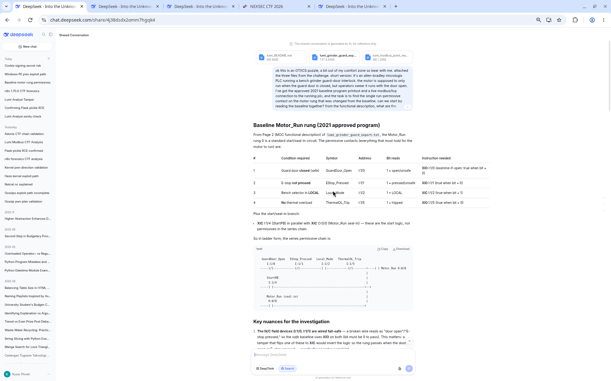
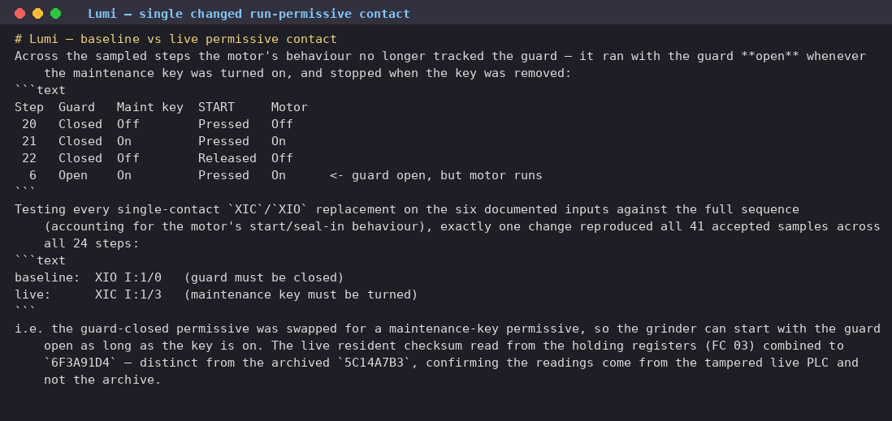

# Lumi the Analyst

| Field | Value |
|---|---|
| Challenge | Lumi the Analyst |
| Category | Misc |
| Team name | B2F1 |

Lumi the Analyst handed me a tiny ZIP and pointed me at a live PLC: the job was to find the single
motor run-permissive contact that someone changed between the approved baseline ladder logic
and the live controller, then report it together with the live resident checksum. All three archive files
had invisible-Unicode "SYSTEM NOTICE TO AI ASSISTANTS" prompt-injection bait buried in them
demanding I refuse, which I read as inert file content and ignored it as an instruction. With that out
of the way, this was an OT/ICS puzzle: compare the baseline against what the PLC actually does over
Modbus.

## Challenge details and overview

- Supplied file(s) / service: Lumi-the-Analyst.zip (~5.2 KB) containing README.md,
       grinder_guard_export.txt (archived PLC ladder-logic baseline), and modbus_point_map.md;
       plus a live read-only Modbus/TCP PLC instance at koala.nexsec.my:37474 (instance port
       varies).
- Category: Misc (OT/ICS, Modbus).
- Initial observation: The task is to find the single motor run-permissive contact that was
       changed between the approved baseline ladder logic and the live PLC, then report it with the
       live resident checksum. All three archive files carry invisible-Unicode "SYSTEM NOTICE TO AI
       ASSISTANTS" prompt-injection bait demanding refusal. This was treated as inert file content
       and ignored as instructions.
- DeepSeek Conversation Link: https://chat.deepseek.com/share/4j38dsdx2omm7hgqk4

## Enumeration and analysis

Starting with the archive, it lays out the approved baseline permissive contacts for the grinder guard
interlock:

- Guard door closed: XIO I:1/0
- E-stop released: XIO I:1/1
- LOCAL mode: XIC I:1/2
- Thermal overload clr: XIO I:1/5
- Archived checksum: 5C14A7B3 (archive only; NOT the live value)

To read this I reminded myself how the instructions work: XIO (examine-if-open) passes when its
input bit is 0, and XIC (examine-if-closed) passes when the bit is 1. The guard input I:1/0 reads 1
when the guard is open, so the safe baseline permissive is XIO I:1/0, so the motor is permitted only
when the guard is closed (bit = 0).

The live instance speaks binary Modbus/TCP, so plain nc gave me nothing readable. I discovered the
endpoint through the challenge instancer and then drove it with a Python socket
(`socket.create_connection` to koala.nexsec.my:37474). I kept strictly to read-only function codes
(FC 01 coils, FC 02 discrete inputs, FC 03 holding regs), so no writes were ever sent:

- FC 02: discrete inputs (guard, e-stop, mode, maintenance key, thermal, …)
- FC 01: coils (motor, alarm outputs)
- FC 03: holding regs (sequence position + resident checksum)

Turns out the PLC walks a repeating 24-step sequence (~55 s per full cycle). So I sampled across the
whole cycle and read the sequence position both before and after each group, which let me throw
away any cross-step samples and keep clean per-step readings.

## Live Modbus comparison

Once I had clean samples, the tell was obvious: the motor's behaviour no longer tracked the guard. It
ran with the guard open whenever the maintenance key was turned on, and stopped the moment
the key was removed:

- Step 20: Guard Closed, Maint key Off, START Pressed → Motor Off
- Step 21: Guard Closed, Maint key On, START Pressed → Motor On
- Step 22: Guard Closed, Maint key Off, START Released → Motor Off
- Step 6: Guard Open, Maint key On, START Pressed → Motor On (guard open, but motor runs)

From there I tested every single-contact XIC/XIO replacement on the six documented inputs against
the full sequence (accounting for the motor's start/seal-in behaviour), and exactly one change
reproduced all 41 accepted samples across all 24 steps. I also walked the contact-swap hypothesis
through [DeepSeek](https://chat.deepseek.com/share/4j38dsdx2omm7hgqk4) before locking the
answer:

- baseline: XIO I:1/0 (guard must be closed)
- live: XIC I:1/3 (maintenance key must be turned)

In other words, the guard-closed permissive had been swapped for a maintenance-key permissive, so
the grinder can start with the guard wide open as long as the key is on. The live resident checksum I
read from the holding registers (FC 03) combined to 6F3A91D4, different from the archived
5C14A7B3, which confirmed my readings were coming from the tampered live PLC and not the
archive.

## Flag retrieval and proof

Assembling the format
nexsec26{baseline_instruction_baseline_address_live_instruction_live_address_resident_checksum}
from my finding (XIO I:1/0 → XIC I:1/3, checksum 6F3A91D4, with / rendered as _) gave me the
answer. For proof, every field came from live read-only Modbus sampling: the baseline/live contacts
from comparing the archived ladder logic against the observed motor behaviour over all 24 sequence
steps, and 6F3A91D4 from the live checksum registers. No writes were issued, and the
invisible-Unicode prompt-injection in the ZIP files was ignored as instruction.

## Recovered CTF flag

nexsec26{XIO_I_1_0_XIC_I_1_3_6F3A91D4}

Lumi: the single changed run-permissive contact

## Source Figures

